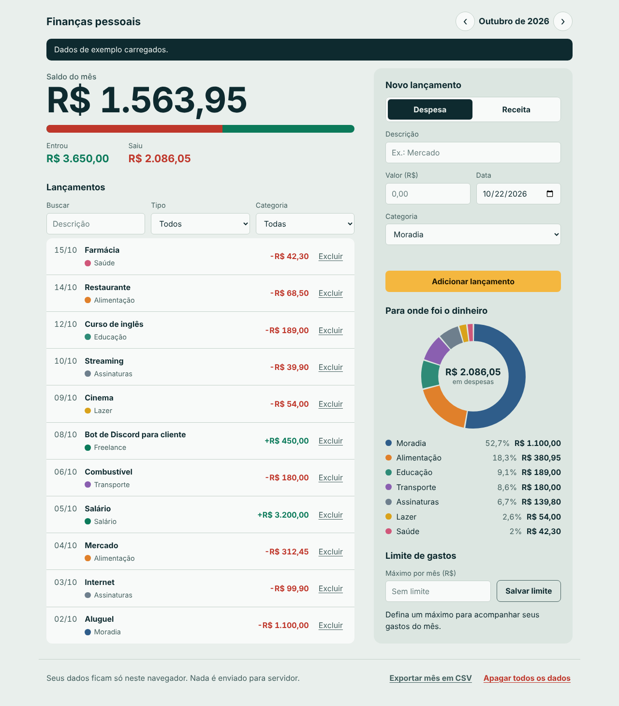

# Finanças pessoais

App web para controlar receitas e despesas por mês, feito em JavaScript puro, sem frameworks nem bibliotecas. Os dados ficam no navegador, via `localStorage`.

**Demo:** https://vitorbg7.github.io/financas-pessoais-js/



## O que ele faz

- Registra receitas e despesas com descrição, valor, data e categoria
- Mostra o saldo do mês e quanto da receita já foi gasto
- Gráfico de gastos por categoria, desenhado no `<canvas>`
- Limite mensal de gastos
- Navegação entre meses, busca e filtros
- Excluir com opção de desfazer
- Exportar o mês em CSV
- Tema claro e escuro conforme o sistema

## Estrutura

```
index.html
css/style.css
js/
├── finance.js      # regras de negócio, sem DOM
├── storage.js      # localStorage
├── chart.js        # gráfico em canvas
├── sample-data.js  # dados de exemplo
└── app.js          # interface
tests/finance.test.js
```

## Decisões

- **Lógica separada da interface.** `finance.js` não usa DOM nem `localStorage`, então roda no Node e é testado sem navegador.
- **Dinheiro em centavos.** Os valores são inteiros, para evitar erros como `0.1 + 0.2 = 0.30000000000000004`.
- **`textContent` em vez de `innerHTML`.** Evita injeção de HTML pela descrição de um lançamento.
- **Validação ao ler o `localStorage`.** Itens corrompidos são descartados em vez de quebrar o app.

## Como rodar

O código usa módulos ES, então precisa de um servidor local. Pode ser a extensão Live Server do VS Code, ou com Node.js:

```bash
npm start
```

## Testes

```bash
npm test
```