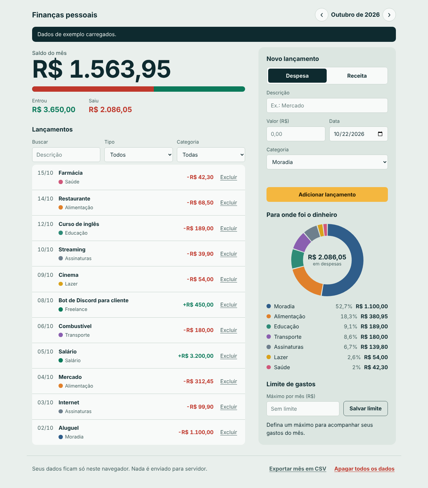

# Finanças pessoais

🇧🇷 Português · [🇺🇸 English](README.md)

App web para controlar receitas e despesas por mês, feito em **JavaScript puro** (sem frameworks e sem bibliotecas). Os dados ficam só no navegador, via `localStorage`.



## O que ele faz

- Registra receitas e despesas com descrição, valor, data e categoria
- Mostra o saldo do mês e uma barra com a parte da receita que já foi gasta
- Gráfico de rosca com os gastos por categoria, desenhado direto no `<canvas>`
- Limite mensal de gastos, com aviso quando estoura
- Navegação entre meses, busca e filtros por tipo e categoria
- Excluir com opção de **desfazer**
- Exportar o mês em CSV (abre direto no Excel)
- Tema claro e escuro automáticos, conforme o sistema
- Funciona no celular

## Tecnologias

- HTML, CSS e JavaScript (módulos ES, sem build)
- Node.js `node:test` para os testes da lógica
- Sem dependências

## Estrutura

```
index.html
css/style.css
js/
├── finance.js      # regras de negócio (puro, sem DOM): valores, datas, filtros, relatórios, CSV
├── storage.js      # leitura e escrita no localStorage, com tratamento de erros
├── chart.js        # gráfico de rosca em canvas
├── sample-data.js  # dados de exemplo
└── app.js          # interface: eventos e atualização da tela
tests/finance.test.js
```

## Decisões de projeto

- **Lógica separada da interface.** Tudo que é regra (calcular saldo, validar lançamento, filtrar, gerar CSV) fica em `finance.js`, que não toca em DOM nem em `localStorage`. Por isso roda no Node e é testado sem abrir navegador.
- **Dinheiro em centavos.** Os valores são números inteiros, nunca decimais, para evitar erros como `0.1 + 0.2 = 0.30000000000000004`. Entradas como `1.234,56` e `R$ 10` são convertidas por um parser próprio, e meio centavo é recusado em vez de arredondado.
- **Sem injeção de HTML.** Textos digitados pelo usuário entram na página com `textContent`, nunca com `innerHTML`.
- **CSV seguro.** Células que começam com `=`, `+`, `-` ou `@` recebem um apóstrofo, para que o Excel não execute como fórmula.
- **Dados corrompidos não quebram o app.** Ao ler o `localStorage`, cada item é validado e os inválidos são descartados.
- **Acessibilidade.** Foco visível por teclado, rótulos em todos os campos, avisos em regiões `aria-live`, contraste revisado nos dois temas e respeito a `prefers-reduced-motion`. Ao excluir um item, o foco vai para o título da lista.

## Como rodar

Como o código usa módulos ES, o navegador precisa abrir a página por um servidor local (abrir o `index.html` direto do disco não funciona).

**Com o VS Code:** instale a extensão *Live Server*, clique com o botão direito em `index.html` e escolha *Open with Live Server*.

**Com Node.js:**

```bash
npm start
```

Na primeira vez, clique em **Carregar dados de exemplo** para ver o app preenchido.

## Testes

```bash
npm test
```

Cobrem conversão de valores, datas, validação de lançamentos, filtros (com busca sem diferenciar acentos), relatórios por categoria, limite de gastos, CSV e os dados de exemplo.

## Publicar no GitHub Pages

1. No repositório, abra **Settings > Pages**.
2. Em **Build and deployment**, escolha **Deploy from a branch**.
3. Selecione a branch `main` e a pasta `/ (root)` e clique em **Save**.
4. Depois de um ou dois minutos, o app fica no ar em `https://SEU-USUARIO.github.io/NOME-DO-REPOSITORIO/`.

## Próximos passos

- [ ] Editar um lançamento existente
- [ ] Lançamentos recorrentes (aluguel, assinaturas)
- [ ] Comparar o mês atual com o anterior
- [ ] Versão em React Native, reaproveitando `finance.js`
